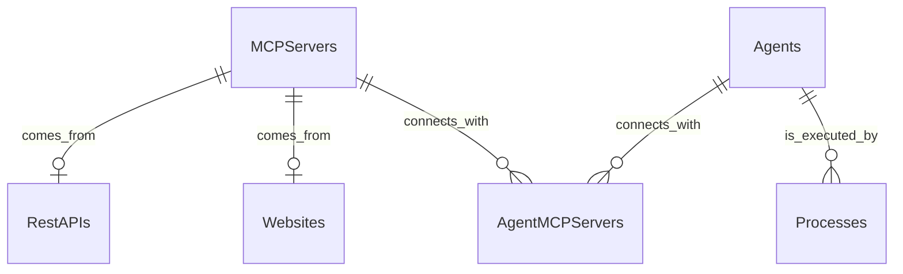

# Πανεπιστήμιο Πειραιώς - Προηγμένα Πληροφοριακά Συστήματα
## Διπλωματική Εργασία: Αυτόματη Δημιουργία MCP Servers από Διαδικτυακούς Πόρους με WebMCP κι από APIs με Open API Specification

### Περιγραφή
Στα πλαίσια της Διπλωματικής Εργασίας υλοποιήθηκε το παρόν Πληροφοριακό Σύστημα, το οποίο επιτρέπει
στον χρήστη να ορίζει MCP Servers από ιστοσελίδες που υποστηρίζουν το WebMCP , καθώς κι από APIs με
Open API specification.
Επιπλέον, ο χρήστης έχει τη δυνατότητα να εγκαταστήσει τοπικά LLMs και να δημιουργήσει τους δικούς του
AI Agents. Μέσω αντίστοιχου chat, μπορεί να επικοινωνεί με αυτούς. Η εκτέλεση ενός Agent πραγματοποιείται
μέσω διεργασίας του Λειτουργικού Συστήματος σε συγκεκριμένο port που ορίζει ο χρήστης.

### Εγκατάσταση
Χρειάζεται η εγκατάσταση του <b>docker desktop</b> στον Η/Υ προκειμένου να εκτελεστεί η εφαρμογή, εκτελώντας την εντολή
<code>docker compose up -d</code> στο root folder από το CLI. Αφού ολοκληρωθεί η δημιουργία των images και των
αντίστοιχων containers, ο χρήστης μπορεί μέσω browser να μεταβεί στο http://localhost:8501 για να εισέλθει στην εφαρμογή.

### Βάση Δεδομένων

### Τεχνολογίες
Χρησιμοποιήθηκε η γλώσσα προγραμματισμού <b>python 3.14</b> για την υλοποίηση του Πληροφοριακού Συστήματος. Η
αυτόματη μετατροπή των API endpoints σε αντίστοιχα MCP tools έγινε με τη βοήθεια του <code>fastmcp</code> library.
Για την ανάγνωση των WebMCP tools μιας ιστοσελίδας χρησιμοποιήθηκε η βιβλιοθήκη <code>playwright</code>
και η <code>langchain</code> για την υλοποίηση των AI Agents. Με την <code>subprocess</code> εκτελούνται
οι Agents ως διεργασίες στο λειτουργικό σύστημα, ενώ εσωτερικά με τη βοήθεια της βιβλιοθήκης <code>flask</code> τρέχει
ένας server που ακούει σε συγκεκριμένο port, ώστε να μπορεί ο χρήστης να επικοινωνεί με τον Agent.

<i>Επιβλέπων Καθηγητής: [κ. Ανδρέας Μενύχτας](https://www.ds.unipi.gr/faculty/amenychtas/)</i>